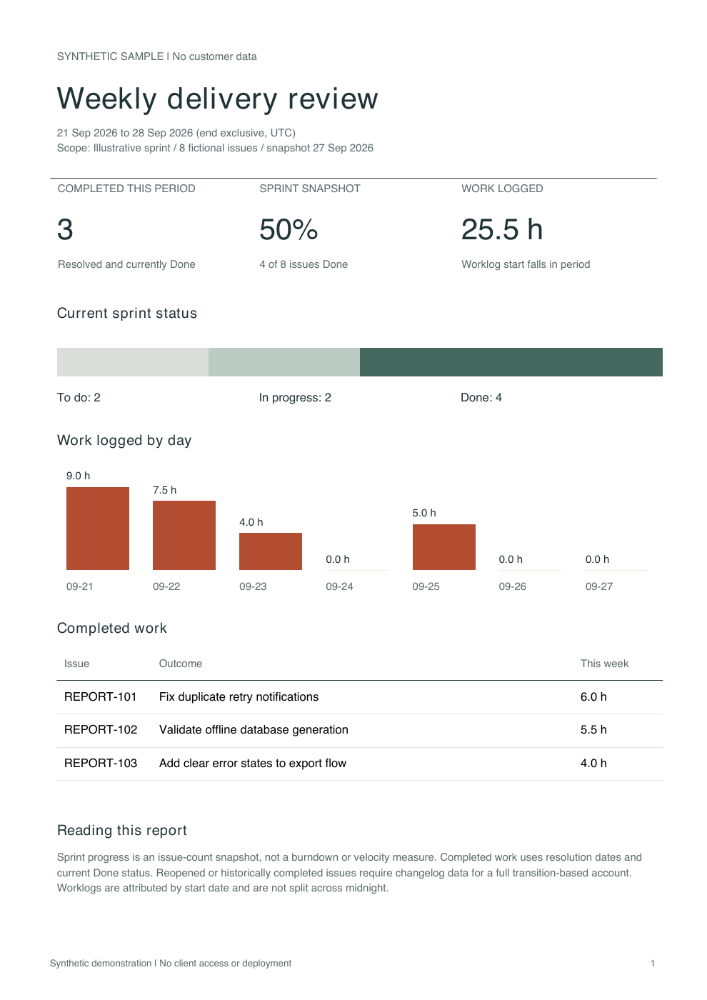
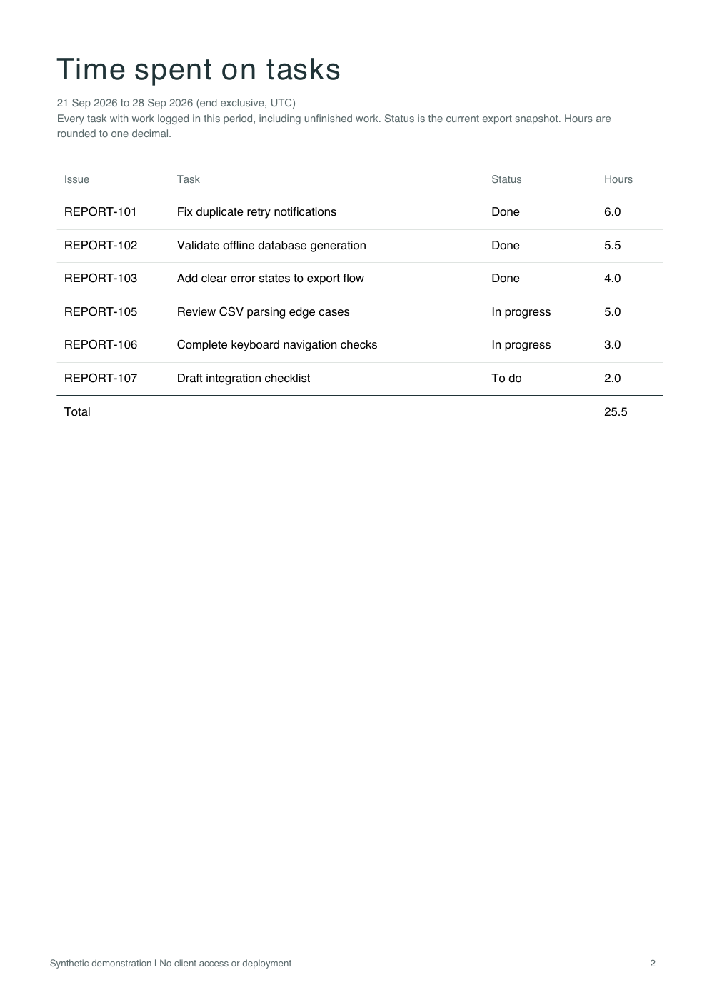

# Jira weekly PDF report sample

A bounded response to Freelancer project 40735359, Jira Weekly Report Automation.
This is a local export-to-PDF implementation with synthetic fixtures. It has not
been connected to a client Jira instance, scheduled, or accepted by a client.

[View the sample PDF](examples/weekly-report.pdf) · [Source fixture](sample.json)



The second page itemizes every task with work logged during the week, including
in-progress and to-do tasks. Its total reconciles with the overview; completed
tasks remain a separate section. Long task lists continue with repeated headers.



## Run

Requires Python 3.11+.

```sh
python3 -m venv .venv
.venv/bin/pip install -r requirements-dev.txt
.venv/bin/python -m unittest -v
.venv/bin/python report.py sample.json \
  --start 2026-09-21T00:00:00Z --end 2026-09-28T00:00:00Z \
  --output weekly-report.pdf
```

No network requests, credentials, Jira changes or external delivery occur. An
existing scheduler can invoke this command weekly after a complete export has
arrived. Deployment/scheduling needs the client's target environment and approval.

## Input contract

`sample.json` shows the shape. Use a complete export of the agreed sprint/scope,
not just issues updated this week: that would bias the sprint denominator. Each
issue needs key, summary, status category, resolution date and complete worklogs.
The outer `total` and each worklog `total` must be explicit integers matching the actual records. The
program rejects partial pages and duplicates instead of undercounting silently.
The caller must also ensure permission-filtered exports represent the intended
scope; counts cannot detect records hidden by Jira permissions.

The labels `project` and `scope` should identify the sprint and snapshot time.
Use `synthetic: true` for demonstration data. Remove it only for an authentic,
authorized export; never relabel mock data as a customer result.

- Completed this period: resolution date in `[start, end)`, currently Done.
- Sprint completion: current Done issue count / all supplied sprint issues.
- Hours: timeSpentSeconds of worklogs whose start falls in `[start, end)`.
- All timestamps require timezone offsets and are normalized to UTC.
- Work spanning midnight is attributed by its start; it is not split.
- Full historical completion/reopen reporting needs changelog data, which this
  sample does not fetch. This is not a burndown, story-point velocity or billing
  calculation.

## Before a client delivery

Confirm Jira Cloud versus Data Center, sprint/filter scope, reporting timezone,
what Done means, worklog visibility, export completeness, scheduling host and
preferred PDF branding. Development should use sanitized exports or synthetic
fixtures. This demonstration did not access real customer data.

The PDF uses built-in Latin fonts; CJK/other script font embedding would be a
separate confirmed layout requirement. Public proposal claims are limited to the
included implementation and 13 tests, including actual PDF extraction for empty,
normal and 60-task multi-page reports. Developed with AI assistance.
